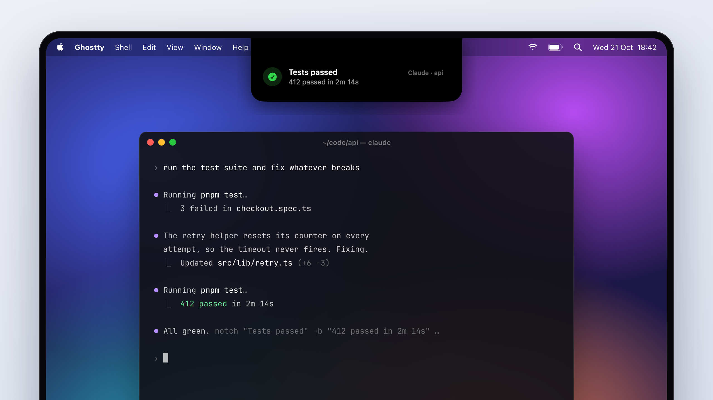
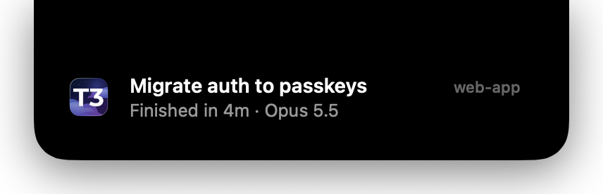
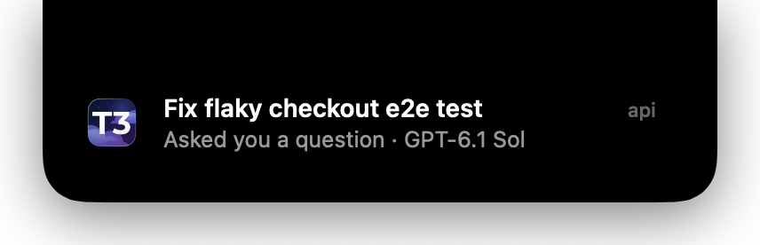
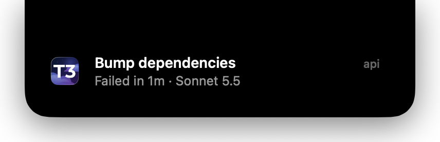
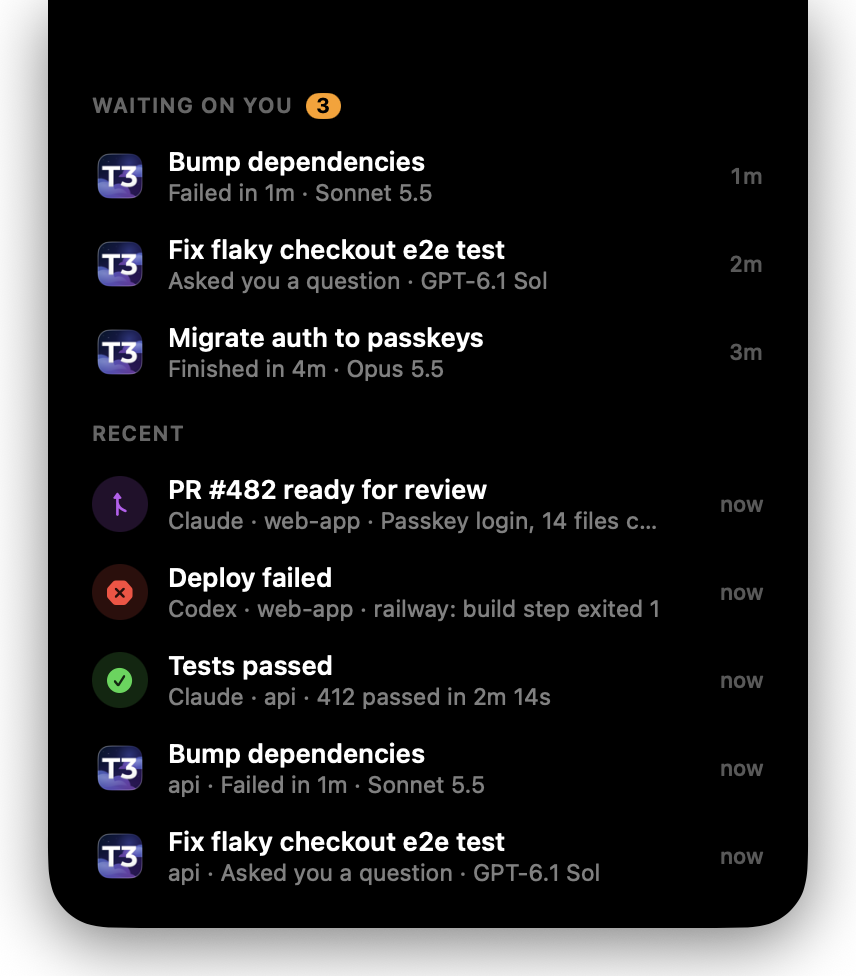
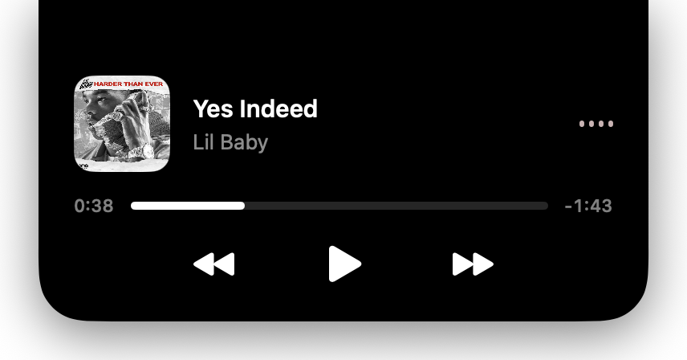

# notch-island



A Dynamic Island for the Mac. Messages, agent status, your calendar and Spotify drop out of
the notch as a black island, and anything that can run a shell command can
send one:

```sh
notch "Tests passed" -b "412 passed in 2m 14s" -s "Claude · api" -i checkmark.circle.fill -c green
```

It was built for coding agents: they finish, fail or get stuck while you're in
another window, and a banner from the notch is hard to miss without being a
full macOS notification. Every message is kept, so you can catch up from the
inbox later.

## What it does

**Messages from any program.** `notch` shows a banner with an icon, title, an
optional second line and a small source label. Banners queue, hide after 5
seconds, pause while hovered, and can open a URL or run a command when clicked.

**Live agent status.** If T3 Code is installed, Island shows what your agents
are doing as it happens. While any thread is working or waiting on you, the
notch grows small wings: a spinner with how many are working on the left, and
how many need you (orange) or have finished unread (green) on the right. Click
or hover them for the full list, with each thread's state, project, model and
running time; click a thread to open it in T3. (`notch --agents` opens the list directly. Banners for finished
threads are off by default; set `"t3Banners": true` in the config to get them
too.)

<p align="center">
  
  
  
</p>

**Slack (or any app's) notifications.** List apps in the config and their
macOS notifications drop out of the notch instead, with bursts merged into one
"3 new Slack messages" banner:

```json
{ "mirrorNotifications": ["com.tinyspeck.slackmacgap"] }
```

Island reads them from macOS's notification database, so it sees exactly what
the app would notify you about, with no tokens. That file is protected: give
Island **Full Disk Access** in System Settings → Privacy & Security. To avoid
seeing each one twice, set the app's alert style to *None* in System Settings
→ Notifications (keep "Show in Notification Center" on).

**AirPods.** When AirPods or other Bluetooth headphones connect, the notch
shows them with a battery ring for a few seconds, like on iPhone, with a sound.
Set `"deviceSound"` to a system sound name or an audio file to change it, or
`"deviceAlerts": false` to turn it off. `notch --preview-device "AirPods Pro"`
shows it without connecting anything.

**An inbox.** Threads still waiting on you, and your recent messages. Click a
row to open it.

<p align="center">
  
</p>

**Spotify.** Cover art, a seekable progress bar and playback controls.

<p align="center">
  
</p>

**Calendar.** The rest of today and tomorrow from the calendars in
Calendar.app, with time left for the current event and a Join button for
Meet, Zoom, Teams, Whereby and Webex links; clicking a call joins it too. Declined, cancelled, all-day and
out-of-office events are hidden. Open it with `notch --calendar`, e.g. from a
status bar item.

**Hover the notch** (or press Caps Lock, see below) for an overview: your next
event (with Join), your agents and Spotify, side by side. Click a tile to open
it; move away to close.

On a Mac with a notch the island grows out of it; on other screens it grows out
of the top edge. It appears on whichever screen the mouse is on.

## Install

Needs macOS 14 or later, Swift 5.9+ (Xcode or the Command Line Tools) and [just](https://github.com/casey/just) (`brew install just`).

```sh
git clone https://github.com/hmbakhsh/notch-island
cd notch-island
just install
```

This builds `Island.app` into `~/Applications`, links the `notch` CLI into
`~/.local/bin` (put that on your `PATH`), and adds a login item so Island runs
in the background. `just uninstall` removes all three.

The first time the Spotify or calendar panel is used, macOS asks for
permission to control Spotify or read your calendars.

To show only some calendars, list their names (as shown in Calendar.app) in
`~/.config/notch-island/config.json`:

```json
{
  "calendars": [
    { "name": "me@work.com", "label": "Work", "color": "#4C8DFF" },
    { "name": "Personal", "label": "Personal", "color": "#34C759" }
  ]
}
```

A plain name (`"Personal"`) works too. With a `label`, each event gets a small
chip in that colour saying which calendar it's from, so work and personal are
easy to tell apart. Without `calendars`, every calendar except birthdays and
subscribed ones is shown.

To open the overview with **Caps Lock**, add `"capsLockTrigger": true` to the
same file and restart Island (`just install`). Island remaps Caps Lock to F18
(a key Mac keyboards don't have) with `hidutil` and listens for that, so it
needs no Accessibility permission; other key remaps are kept. If you've set
Caps Lock to another key in System Settings → Keyboard → Modifier Keys, Island
follows that too when it's a right-side modifier (built-in keyboards don't
have those); otherwise set Caps Lock back to "⇪ Caps Lock" there. While it's open
from Caps Lock, **1** opens your calendar, **2** opens the agents list, and **3** plays or
pauses Spotify; hold Caps Lock and press the number, or tap one then the other.
Both lists open with the first row highlighted: ↑ ↓ move, ⏎ opens it (the
thread in T3, or the event's call, else the event in Calendar), so joining your
next call is Caps Lock, 1, ⏎. The number and arrow keys are only taken while
the island is open from the keyboard. **Esc** closes the
overview or any panel (banners leave Esc to the app you're typing in). To use a different
key, bind `notch --home` in Raycast, skhd or similar instead.

## Sending messages

```sh
notch TITLE [BODY] [options]
```

| Option | |
|---|---|
| `-b, --body TEXT` | Second line, wraps to two lines |
| `-s, --source TEXT` | Small label top-right, e.g. `Claude · api` |
| `-i, --icon NAME` | [SF Symbol](https://developer.apple.com/sf-symbols/) name |
| `-a, --app NAME` | Use an app's icon, e.g. `Slack` |
| `--image PATH` | Use an image file |
| `-c, --color COLOR` | `red orange yellow green mint teal blue indigo purple pink gray` or `#RRGGBB` |
| `-t, --time SECONDS` | How long it stays (default 5) |
| `--sticky` | Stay until clicked or dismissed |
| `-o, --open URL\|PATH` | Open on click |
| `-r, --run COMMAND` | Run a shell command on click |
| `--sound NAME` | System sound: `Glass`, `Ping`, `Submarine`, … |
| `--json JSON` | All of the above as JSON; `--json -` reads stdin |
| `--dismiss` | Hide the banner on screen now |
| `--inbox` | Open or close the inbox |
| `--spotify` | Open or close the Spotify panel |
| `--calendar` | Open or close upcoming calendar events |
| `--home` | Open or close the overview |
| `--agents` | Open or close the live list of T3 agents |

From a program, `--json` is easiest:

```sh
echo '{"title": "Backup done", "body": "38 GB in 12m", "icon": "externaldrive.fill", "color": "teal"}' | notch --json -
```

History is kept in `~/.local/state/notch/history.jsonl`, one JSON object per
line.

## Coding agents

`integrations/agents/notch/SKILL.md` is an [agent skill](https://docs.claude.com/en/docs/claude-code/skills)
that tells an agent when to notify you and how. Link it into your skills folder:

```sh
ln -s "$PWD/integrations/agents/notch" ~/.claude/skills/notch
```

## Status bars

Island keeps two counts: threads waiting on you, and messages you haven't seen
in the inbox. On every change it writes them to
`~/.local/state/notch/status.json` and, if [SketchyBar](https://github.com/FelixKratz/SketchyBar)
is installed, fires its `island_update` event with `WAITING` and `UNREAD`.

For SketchyBar there's a ready-made bell and Spotify item. Source it from your
`sketchybarrc` after your other right-side items:

```sh
ISLAND_DIR="/path/to/notch-island/integrations/sketchybar"
source "$ISLAND_DIR/island.sh"
```

The bell is orange with a count while threads wait on you and white when there
are unseen messages; clicking it opens the inbox. The Spotify items show the
track while it plays and open the player when clicked. The icons need a
[Nerd Font](https://www.nerdfonts.com); see the top of `island.sh` to change
them.

## How the T3 integration works

T3 Code has no public API for thread status, so Island reads its local state
database (`~/.t3/userdata/statev2.sqlite`) read-only every 4 seconds. It skips
archived, settled, snoozed and subagent threads. Because these are T3's
internal tables, a T3 update can change them; if that happens Island stops
reporting T3 threads rather than failing.

## Development

```sh
just run                          # debug build in the foreground
ISLAND_SLOWMO=8 just run          # slow animations down 8x
just screenshots                  # regenerate docs/screenshots from demo data
just hero                         # re-render the README hero from docs/hero/hero.html
```

| Variable | |
|---|---|
| `ISLAND_STATE_DIR` | Where history and status live (default `~/.local/state/notch`) |
| `ISLAND_T3_DB` | T3 database to watch |
| `ISLAND_ANNOUNCE_EXISTING=1` | Announce threads already waiting at startup |
| `ISLAND_SLOWMO` | Multiply animation durations |

## License

MIT
